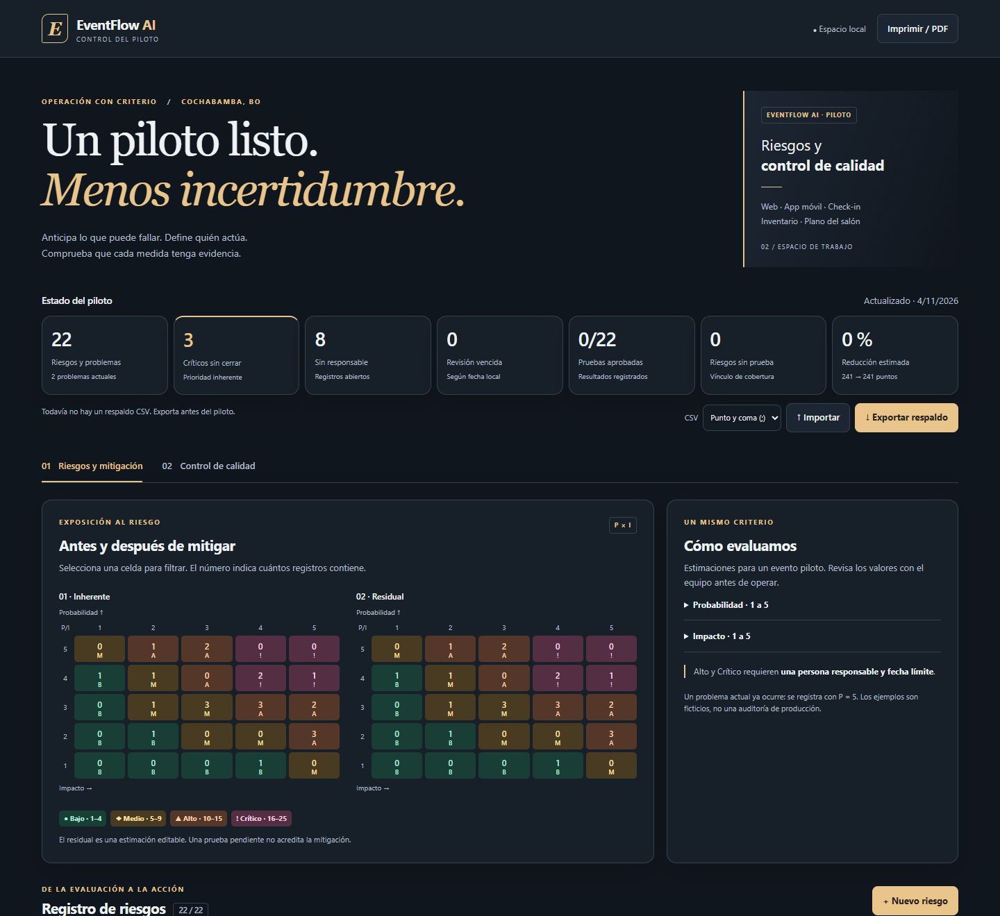

# EventFlow AI · Riesgos y calidad

Espacio de trabajo estático para preparar el piloto de EventFlow AI en Cochabamba: web, app móvil, check-in, inventario y plano del salón. Permite priorizar riesgos, asignar mitigaciones y registrar pruebas de aceptación con evidencia. No ejecuta los servicios de EventFlow ni conecta una base de datos por defecto.

[Web publicada](https://mattupapi-art.github.io/eventflow-riesgos-calidad/) · [Rama v2 de revisión en el fork](https://github.com/mattupapi/eventflow-riesgos-calidad/tree/mejoras-v2)

La web publicada sigue la rama `main` del repositorio original. Los cambios v2 permanecen en revisión hasta que el propietario autorice integrarlos.



## Ejecutar

Necesitas Node 22 o superior. No hay build ni dependencias de ejecución.

```sh
npm start
```

Abre `http://127.0.0.1:4173`. Usa un servidor HTTP: los módulos ES no se deben abrir mediante `file://`. Los datos pertenecen al origen del navegador; localhost y GitHub Pages tienen almacenamientos separados.

## Qué incluye

- 22 escenarios ficticios, incluidos 2 problemas actuales, y 22 pruebas de aceptación con metas medibles. Ninguna empieza aprobada.
- Matrices 5×5 inherente y residual, filtros por celda, búsqueda, categoría, estado, persona, prioridad y tipo. Encabezados para ordenar; tarjetas en móvil.
- Responsables separados en persona y rol, fechas de mitigación/revisión, contingencia y cambios por campo.
- Pruebas vinculadas con riesgos; tablero Pendiente/Aprobada/Fallida y evidencia fechada.
- CSV con vista previa, respaldo, sincronización local entre pestañas, recuperación y restablecimiento confirmado.
- Tema claro/oscuro según sistema, teclado, foco visible y vista para imprimir/PDF con ambas secciones. La impresión del registro respeta los filtros activos: límpialos para incluir todos los riesgos.

Los nombres terminados en «Demo» son ficticios. Sustitúyelos y revisa las estimaciones antes de operar. Los escenarios no acreditan problemas observados en el sistema real.

## Modelo y prioridad

El estado contiene `schemaVersion: 2`, `risks`, `checks`, `revision`, `exportedRevision`, `lastExportAt`, `updatedAt`, `risksCounter` y `checksCounter`.

| Registro | Campos |
| --- | --- |
| Riesgo | `id`, `title`, `area`, `category`, `type`, `p`, `i`, `residualP`, `residualI`, `owner` (persona), `role`, `status`, `consequence`, `action`, `contingency`, `dueDate`, `reviewDate`, `updatedAt`, `history` |
| Prueba | `id`, `title`, `area`, `criteria`, `status`, `evidence`, `evidenceDate`, `risks` (array de IDs), `updatedAt`, `history` |
| Cambio | `date` (ISO), `field`, `before`, `after` (valores como texto; arrays serializados en JSON) |

P e I son enteros de 1 a 5. El producto es el puntaje: **1–4 Bajo**, **5–9 Medio**, **10–15 Alto**, **16–25 Crítico**. El orden predeterminado usa puntaje, impacto, probabilidad e ID. El filtro de prioridad usa exposición inherente; una celda residual filtra por los valores residuales.

La guía de la interfaz define los cinco niveles con ejemplos: probabilidad estimada ≤5 %, 6–20 %, 21–50 %, 51–80 %, >80 %; impacto desde una molestia breve hasta seguridad, exposición de datos o pérdida esencial. Los problemas actuales se precargan con P=5. Los valores son juicio de planificación, no probabilidades medidas.

Al guardar o importar, Alto/Crítico en cualquiera de las dos evaluaciones exige nombre y apellido de una persona y fecha límite. Esto comprueba formato, no verifica identidad. Aprobada/Fallida exige evidencia y fecha. El residual empieza igual al inherente. La reducción es `(suma inherente − suma residual) / suma inherente`, incluye todos los registros y es una **estimación**, no una certificación de mitigación. «Sin prueba» significa sin ningún vínculo, incluso si las pruebas vinculadas siguen pendientes.

## Almacenamiento y recuperación

`getState()` y `saveState()` forman la única interfaz de persistencia. El adaptador activo usa la clave histórica `eventflow-control-v1` en localStorage para conservar datos al actualizar GitHub Pages. La clave permanece; el esquema interior cambia a 2.

La migración conserva registros, puntajes, estados y contadores. Los antiguos responsables por equipo pasan a `role`; `owner` queda vacío, sin inventar una persona. El residual hereda P/I. Fechas e historial ausentes quedan vacíos. La migración se guarda con la siguiente escritura. Se toleran campos de negocio incompletos de v1 al cargar, pero se exigen al guardar o importar.

JSON corrupto, IDs inválidos, estados desconocidos o números fuera de rango muestran un aviso persistente sin sobrescribir la copia original. «Descargar copia guardada» permite conservar el JSON. «Restablecer datos de ejemplo» solicita confirmación y reemplaza el estado. Si falla una escritura, los cambios permanecen en memoria con aviso y se pueden exportar; no cierres esa pestaña sin hacerlo.

El evento `storage` actualiza las otras pestañas del mismo origen. Con un editor abierto se conserva su contenido y se impide guardar sobre una versión externa; ciérralo y carga la nueva versión mediante el aviso. Se comprueba también la versión antes de escribir. localStorage no ofrece una transacción entre pestañas: escrituras exactamente simultáneas aún pueden competir. No es colaboración multiusuario ni almacenamiento cifrado. No guardes listas de invitados o evidencia sensible en esta herramienta de planificación.

## Exportar e importar CSV

Selecciona punto y coma (predeterminado para Excel en español) o coma y pulsa **Exportar respaldo**. Se genera un archivo UTF-8 con BOM, dos secciones independientes para riesgos y pruebas y una cabecera de metadatos con contadores. Comprueba que el navegador complete la descarga. La fecha indica la generación del archivo; la web no puede comprobar que lo hayas conservado fuera del equipo.

Las columnas usan los nombres del modelo. Arrays e historial se representan en JSON dentro de celdas CSV. Se escapan comillas, separadores y saltos de línea y se neutralizan fórmulas con apóstrofo; la importación revierte únicamente esa protección.

1. Elige el mismo separador que usa el archivo.
2. Pulsa **Importar**, selecciona un CSV v2 de máximo 2 MB y revisa los cambios propuestos.
3. Corrige errores si aparecen; ningún dato se aplica parcialmente.
4. Pulsa **Aplicar importación**. Se agrega o actualiza por ID; un registro ausente del CSV no se borra. Los vínculos, IDs duplicados, puntajes y estados se validan. Se conserva el historial existente y se registra cada campo modificado.

No importa el formato combinado antiguo v1 ni hojas arbitrarias de Excel. Exporta primero desde v2 o adapta las columnas a un respaldo v2 de ejemplo. Al borrar un riesgo se quitan sus vínculos de las pruebas y ese cambio queda registrado. Los contadores evitan reutilizar IDs borrados, también al trasladar un respaldo. Restablecer inicia un conjunto de ejemplo nuevo.

Se avisa cuando no hay respaldo, cuando pasan más de siete días desde la exportación o cuando hay cambios posteriores sin exportar.

## Arquitectura

```text
index.html / style.css   Estructura, sistema visual y responsive
app.js                  Interfaz, eventos y coordinación de estado
src/model.js            Cálculo, validación, migración, IDs e historial
src/seeds.js            Escenarios y criterios de aceptación ficticios
src/storage.js          Contrato de almacenamiento y adaptador local
src/csv.js              Exportación, parser y vista previa de importación
src/firestore-adapter.js Adaptador opcional, sin activar
tests/                  Pruebas node:test sin dependencias
scripts/                Servidor local y verificaciones de desarrollo
```

## Firestore opcional (inactivo)

La aplicación no importa Firebase, no carga SDK externos y no incluye configuración ni claves. El adaptador recibe `getDoc`, `setDoc` y una referencia autenticada. Para activarlo se necesita una decisión de arquitectura y trabajo de integración:

1. Crear un entorno Firebase de prueba y definir autenticación. Preparar localmente el SDK y la configuración fuera del repositorio (`firebase-config.local.js` está ignorado). Nunca usar una cuenta de servicio ni claves privadas en el cliente.
2. Tras autenticar al usuario, construir una referencia privada como `users/{uid}/workspaces/pilot` y pasarla al adaptador. Reemplazar la instancia local de `createStorage` en `app.js` por la instancia remota.

```js
// Fragmento de integración: db, auth y SDK deben estar inicializados por el operador.
const reference = doc(db, 'users', auth.currentUser.uid, 'workspaces', 'pilot');
const storage = createStorage(createFirestoreAdapter({ getDoc, setDoc, reference }));
```

3. Adaptar y probar [firestore.rules.example](firestore.rules.example) con [Firebase Emulator Suite](https://firebase.google.com/docs/rules/unit-tests). El ejemplo limita acceso al UID propietario y valida la estructura superior; no valida cada registro de los arrays ni implementa colaboración por evento. Para producción, modelar documentos por registro, validar campos en reglas y probar accesos cruzados, sesiones revocadas y escrituras inválidas. El adaptador no sustituye reglas del servidor.
4. Sustituir la sincronización `storage` y la comprobación de concurrencia de la UI por suscripciones/transacciones del SDK antes de ofrecer colaboración remota. Considerar límites de tamaño, costos y resolución de conflictos. El estado completo en un documento solo sirve como punto de partida.
5. Configurar monitoreo, límites de uso y respaldos. Las [alertas de presupuesto de Firebase](https://firebase.google.com/docs/projects/billing/avoid-surprise-bills) no equivalen a cortar automáticamente el gasto.

El contrato del adaptador está probado con un SDK simulado. **No se ha desplegado ni probado Firebase real ni el ejemplo de reglas en el emulador.** Consulta las [condiciones de reglas oficiales](https://firebase.google.com/docs/firestore/security/rules-conditions) antes de integrarlo.

## Verificación

```sh
npm test                 # Node: lógica, migración, validación, CSV e IDs; sin npm ci
npm ci                   # Solo para instalar herramientas de desarrollo
npm start                # Mantener en otra terminal
npm run test:browser     # Chrome instalado: flujos reales, axe, responsive y PDF
npm run audit:lighthouse # Lighthouse móvil: exige >90 en las tres categorías
```

Los scripts de navegador usan Chrome instalado, sin descargar Chromium. Lighthouse usa la ruta habitual de Chrome en Windows; en otro sistema establece `CHROME_PATH`. `TEST_URL` permite evaluar otro servidor. Los artefactos se escriben en `artifacts/` (ignorado). `node scripts/capture.mjs` actualiza la captura ficticia del README en `docs/screenshot.png` y las vistas de móvil/impresión en `artifacts/`. `node scripts/social.mjs` regenera la imagen social desde HTML/CSS.

GitHub Actions ejecuta `npm test` en cada push y pull request, sin instalar herramientas de navegador. Los resultados, entorno y límites de la ejecución realizada se documentan en [docs/VERIFICATION.md](docs/VERIFICATION.md).

## Publicación

El proyecto se sirve directamente desde la raíz con `.nojekyll`. Configura GitHub Pages con **Deploy from a branch → main → /(root)** en el repositorio original. No necesita secretos ni comandos de build. Los recursos usan rutas relativas para funcionar bajo `/eventflow-riesgos-calidad/`.

La rama de entrega es `mejoras-v2` en el fork `mattupapi/eventflow-riesgos-calidad`. Revisa el diff, los resultados y el contenido; solo después de la autorización del propietario se integra en `main`. El merge dispara la publicación existente. Verifica entonces la URL en vivo y la vista previa de WhatsApp: el repositorio de revisión no modifica la web publicada.

No se añade LICENSE por decisión del propietario. [CONTRIBUTING.md](CONTRIBUTING.md), [CHANGELOG.md](CHANGELOG.md), [auditoría inicial](docs/AUDIT.md) y [texto de About](docs/ABOUT.md) completan la documentación.
